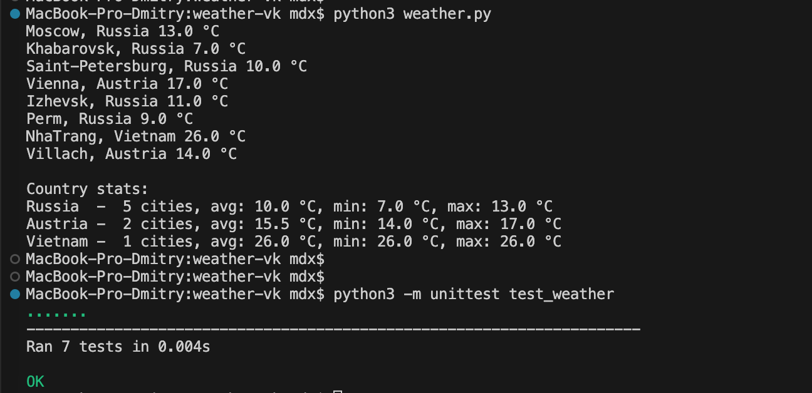

# Weather stats for a list of cities


Fetches the current weather for a list of cities and prints per-city results
plus aggregated stats per country.

## How it works

1. City names are fetched from `https://gistpad.com/raw/vk-task-14`.
2. For each city, current weather is requested from `https://wttr.in/{City}?format=j1`.
3. Results are stored as `WeatherData` objects and grouped by country.
4. Per-country stats (number of cities, average / min / max temperature) are printed.

## Usage

```
python3 weather.py
```

## Tests

```
python3 -m unittest test_weather
```

## Notes

- Uses only the Python standard library (`json`, `urllib.request`, `collections`).
- No external packages required.
- All stats are computed by the code; nothing is hardcoded.
- works on python 3.

## To-Do

- Maybe address a missing country - it becomes an empty string. Those cities get grouped under a blank country name in the stats. Should label them "Unknown" instead.
- Consider remove the `collections` dependency and use a plain `dict` instead rules are read hyper-literally however having `defaultdict` is cleaner, idiomatic

### TL;DR
Output of weather.py and tests:


Per-country temperature stats printed after fetching each city & Stats per Country with min,max,average


